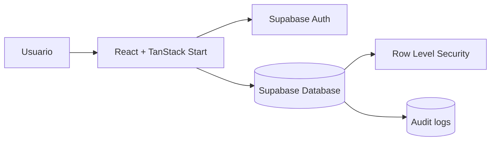

# Arquitectura

## Decision de estructura

El frontend permanece en la raiz del repositorio. La carpeta `api/` se mantiene como referencia historica, pero la aplicacion en ejecucion usa Supabase como unica capa de Auth, base de datos y control de acceso.

## Flujo

## Responsabilidades

Frontend:

- Autenticacion con Supabase.
- Consultas directas a Supabase mediante `@supabase/supabase-js`.
- Paneles por rol.
- Estados de carga, errores, vacios y acciones de usuario.

Supabase:

- Persistencia de perfiles, roles, pacientes, cupos, solicitudes, lista de espera, ofertas, citas, evaluaciones y auditoria.
- Politicas RLS por propietario y rol.
- Restricciones unicas e indices para evitar duplicados y doble reserva.

## Seguridad de decisiones

La priorizacion se calcula en Supabase para la tabla de posiciones y tambien se guarda en `priority_evaluations` al ejecutar `assignNextPatient`, con explicacion auditable. Para una fase posterior, este flujo puede moverse a una Edge Function transaccional si se requiere concurrencia estricta.

## Priorizacion SMARTCITAS_PRIORITY_V2

- 65 anos o mas: 25 puntos.
- 50 a 64 anos: 12 puntos.
- Condicion cronica: 25 puntos.
- Condicion de vulnerabilidad: 15 puntos.
- Tiempo de espera: 2 puntos por dia, hasta 40.
